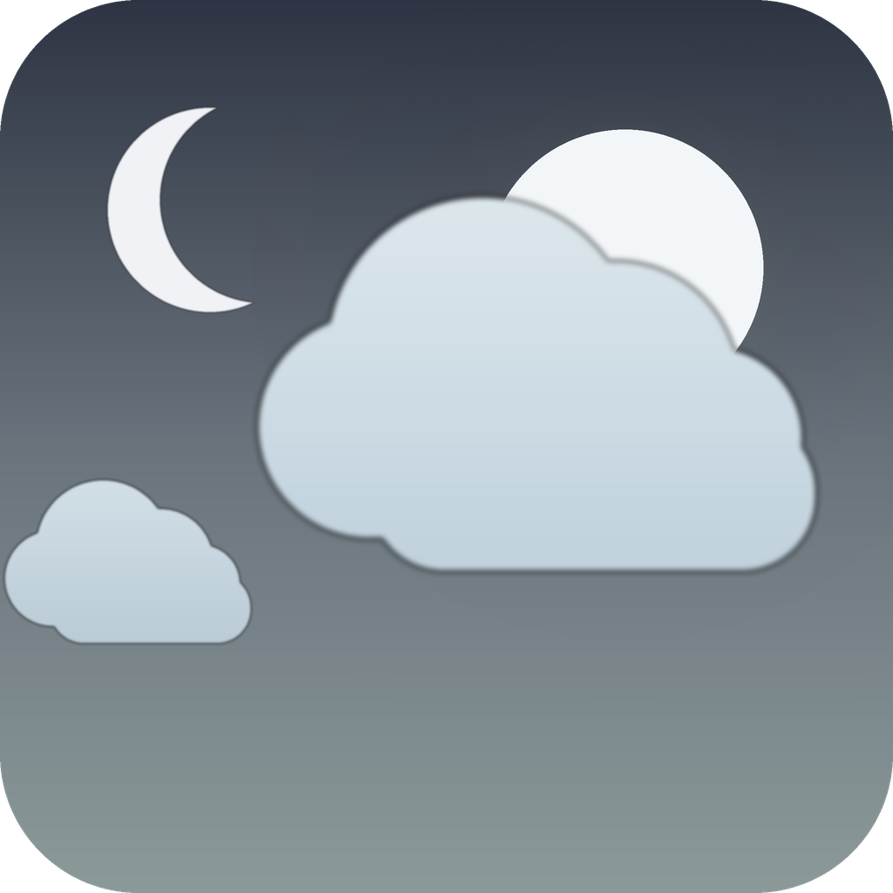

# WeatherScr




-green)

> Weather-driven Windows screensaver: live clock, current conditions, rain alert, and a sky that reacts to real weather.

A Windows `.scr` screensaver whose background **is** the current weather. Clear,
cloudy, fog, rain, snow, thunder and dust each drive their own animated sky, and the
sun, the moon and the stars sit behind the clouds — a big cloud passing in front of
the moon actually covers it. On top of that sits a large clock, a current-conditions
panel, and a rain-risk alert that tells you to take an umbrella before you leave.

It is a Go reimplementation of a subset of
[ShittyRandomPhotoScreenSaver (SRPSS)](https://github.com/Basjohn/ShittyRandomPhotoScreenSaver),
written for a low-power mini PC where the original's footprint was too heavy.
Pure Go, no cgo, Direct3D 11 through [gioui](https://gioui.org).

## Table of Contents

- [Security](#security)
- [Background](#background)
- [Install](#install)
- [Usage](#usage)
- [Behaviour notes](#behaviour-notes)
- [Performance budget](#performance-budget)
- [Development](#development)
- [Maintainers](#maintainers)
- [Thanks](#thanks)
- [Contributing](#contributing)
- [License](#license)

## Security

- **No account, no telemetry, no analytics, no crash reporting.** Nothing leaves your
  machine except the weather requests.
- **One network destination.** `https://api.open-meteo.com` plus the geocoding
  endpoint, no API key, no cookies, no identifiers sent.
- **Request volume is bounded by your refresh interval.** At the default 1 minute the
  geocoding result is cached, so a refresh is one request of about 1.1 kB.
- **Runs as invoker.** The screensaver itself needs no elevation. The installer
  elevates once, only to copy the `.scr` into `C:\Windows\System32`; if that copy
  fails, the registry change is rolled back in the same run.
- **Config and cache are plain files** under `C:\Program Files\WeatherScr\`
  (`config.json`, `weather-cache.json`). They contain your location and nothing else.
- **No credentials anywhere in this repository.** No tokens, no keys, no private
  endpoints. `weather_base_url` is an optional proxy override, empty by default.

## Background

SRPSS is a large, capable Python/PySide6 screensaver. This project keeps four things
from it — the clock, the current-weather panel, the panel's transparency semantics and
the settings keys — and drops everything else, so it can run on a 4-thread x86 mini
host with 2 GB of RAM.

The rewrite is behaviour-level, not code-level: no upstream source, asset or build
file is used. See [NOTICE](NOTICE) and [docs/UPSTREAM.md](docs/UPSTREAM.md) for the
exact scope of the reference and the upstream copyright line.

## Install

### From a release

1. Download `WeatherScr_setup.exe` from the [latest release](../../releases/latest).
2. Run it. The window offers three actions:
   - **Install screensaver** — copies `WeatherScr.scr` to `C:\Windows\System32`,
     points `HKCU\Control Panel\Desktop\SCRNSAVE.EXE` at it, records the previous
     screensaver so uninstall can restore it, creates two desktop shortcuts
     (`WeatherScr - Settings` and `WeatherScr - Start`) and registers an
     entry in *Installed apps*.
   - **Uninstall** — restores the screensaver that was active before the install,
     removes the shortcuts and the *Installed apps* entry.
3. Open *Screen Saver Settings*, pick **WeatherScr**, press **Settings** to open the
   panel.

### From source

```bash
make scr      # builds the .scr (Windows target)
make payload  # builds the .scr and stages it as the installer payload
make setup    # builds WeatherScr_setup.exe
make gate     # build + vet + test + cross-compile, the project's single check
```

Requirements: Go 1.24+, a Windows target. The library packages also build and test on
Linux with `-tags=novulkan`; `cmd/scr` is Windows-only.

### Manual

Copy `WeatherScr.scr` into `C:\Windows\System32`, then set
`HKCU\Control Panel\Desktop\SCRNSAVE.EXE` to `C:\Windows\System32\WeatherScr.scr`
and sign out and back in.

## Usage

### Settings panel

`Screen Saver Settings → WeatherScr → Settings`, or the `WeatherScr - Settings`
desktop shortcut (`WeatherScr.scr /c`). The panel edits every key below, with the
current value pre-filled.

### Configuration keys

Full reference: [docs/CONFIG.md](docs/CONFIG.md). The keys you are most likely to touch:

| Key | Default | Meaning |
| --- | --- | --- |
| `location` | `"Hangzhou, China"` | Place name to geocode. Coordinates win when both are set. |
| `location_lat`, `location_lon` | `0` | Coordinates, used directly, no geocoding request. |
| `display_language` | `"en"` | `en` shows the English name and English labels, `zh` shows Chinese. |
| `units` | `"c"` | `c` metric, `i` imperial. |
| `refresh_minutes` | `1` | Weather refresh interval, floored at 1. |
| `alert_enabled` | `true` | Show the rain-risk alert. |
| `alert_threshold_pct` | `30` | Minimum precipitation probability that triggers the alert. |
| `alert_window_hours` | `3` | Rolling window the probability is read from. `3` or `6`. |
| `alert_pulse` | `true` | Slow 1.2 s breathing on the alert. |
| `alert_y_offset` | `-60` | Vertical placement of the alert, in pixels. |
| `weather_base_url` | `""` | Optional proxy for the forecast API. Empty means the public endpoint. |

### Rain-risk alert

The alert answers one question: **if I leave now, how likely is rain in the next few
hours.** It reads the rolling precipitation probability over `alert_window_hours`, not
the daily maximum, so it moves as the forecast moves.

Tiers follow the Chinese national rainstorm warning thresholds
(蓝/黄/橙/红 = Blue/Yellow/Orange/Red):

| Tier | Trigger | Colour |
| --- | --- | --- |
| Blue | ≥ 30 % | `rgb(30, 111, 217)` |
| Yellow | ≥ 50 % | `rgb(242, 187, 5)` |
| Orange | ≥ 70 % | `rgb(240, 120, 24)` |
| Red | ≥ 90 % | `rgb(217, 38, 38)` |

The panel shows the tier, the probability, the millimetres expected in the window, and
a plain-language action line.

## Behaviour notes

- **Seven visual classes** — `clear`, `cloudy`, `fog`, `rain`, `snow`, `thunder`,
  `dust` — mapped from WMO weather codes, with cloud cover able to promote a clear
  code into `cloudy`.
- **Day and night come from the API's `is_day`**, not from a hard-coded clock.
- **Moon phase is real.** The phase comes from the forecast API's `daily.moon_phase`,
  drawn as the lit shape only, with a glow built from the lit region so the dark side
  is transparent and filled by the halo. New moon draws nothing.
- **Clouds occlude the sun and the moon**, including the large cloud bands. Stars are
  in the sky layer, so clouds pass in front of them too.
- **Class changes crossfade over 9 seconds**, with the incoming clouds entering from
  off-screen. Nothing pops into view in front of you.
- **Cloud drift is speed-controlled** so the sky does not bunch up and then go empty.
- **Panel background is fully transparent** by default, with no border.
- **Wallpaper keys are accepted, not rendered.** `wallpaper_dir` and
  `wallpaper_interval_s` are read and preserved for compatibility with the upstream
  settings shape; this build draws no wallpaper.

## Performance budget

Target for a 4-thread x86 mini host with 2 GB RAM:

| Metric | Budget | Measured |
| --- | --- | --- |
| Resident memory | ≤ 120 MB | 121–142 MB (peak during the class crossfade) |
| Idle CPU | ≤ 5 % of the machine | 4.7 % (18.9 % of one core, 4 threads) |
| Frame rate | 15–20 fps | 15 fps target, adaptive particle reduction below 12 fps |
| `.scr` size | ≤ 15 MB | 12.4 MB |

CPU is measured as the delta of the process CPU time over a 180 s window divided by
wall time. The 120 MB line is met in steady state and exceeded during the crossfade;
that is stated here rather than smoothed away.

## Development

```bash
make gate     # the single check: build, vet, test, Windows cross-compile
make fxshot   # headless renderer (Linux, -tags=novulkan)
make icon     # regenerate the .syso resource from icons/WeatherScr.ico
make clean
```

`cmd/fxshot` renders the production layout path to PNG with no window system, which is
how the visual work is iterated without a display:

```bash
FX_OUT=/tmp/shot FX_MOON=0.174 FX_SHOTS=111,185,296 ./fxshot cloudy
```

It prints, per frame, how many clouds sit on the sun/moon disc and what percentage of
the disc they cover, so a frame is only judged when the measurement proves the event is
in it.

Layout and geometry live in `ui/layout.go`; the particle and cloud-band simulation in
`ui/effects.go`; the sky bake and layer order in `ui/render.go`. Design notes:
[docs/DESIGN.md](docs/DESIGN.md).

## Maintainers

[@DragonTTDream](https://github.com/DragonTTDream)

## Thanks

- **[Basjohn / ShittyRandomPhotoScreenSaver](https://github.com/Basjohn/ShittyRandomPhotoScreenSaver)** —
  Copyright (c) 2026 Jayde Ver Elst / Basjohn, MIT licensed. This project's design
  reference. WeatherScr reimplements a subset of its behaviour in Go and contains none
  of its code.
- **[gioui](https://gioui.org)** — the UI toolkit that makes a pure-Go, cgo-free
  Direct3D 11 screensaver possible.
- **[Kenney](https://kenney.nl)** — the cloud and smoke sprites, released as CC0.
- **[Open-Meteo](https://open-meteo.com)** — weather, forecast and moon-phase data,
  free and keyless.
- The **Chinese national rainstorm warning** thresholds, used for the alert tiers.

## Contributing

See [CONTRIBUTING.md](CONTRIBUTING.md). Run `make gate` before you push; it is the
same check CI would run.

## License

MIT © 2026 DragonTTDream. See [LICENSE](LICENSE) and [NOTICE](NOTICE).
SPDX-License-Identifier: MIT
